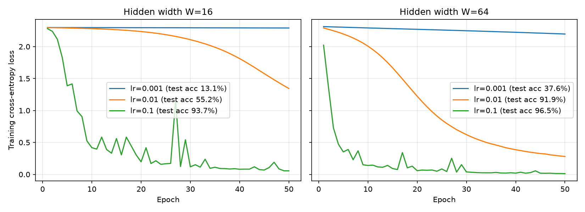

# Lab 2 – Neural network from scratch

Two-hidden-layer MLP on `load_digits`, written in plain NumPy (no PyTorch).

Files:

- `nn.py` – data loading, init, forward, loss, backward, SGD step
- `checks.py` – output shape / softmax check, initial loss check, gradient check
- `train.py` – training runs for all lr/width combinations, saves the loss plot
- `timing.py` – forward vs backward timing
- `results/` – outputs from my runs (checks.txt, train_log.txt, timing.txt, loss_curves.png)

To run (from this folder): `python checks.py`, `python train.py`, `python timing.py`.
Python 3.12, numpy 2.5.4, scikit-learn 1.9.1, matplotlib 3.11.2.

## 1. Data

`load_digits` gives 1797 images of 8x8 = 64 pixels with values 0–16. I divided by 16 so inputs are in [0, 1] and one-hot encoded the labels. 70/30 stratified split with `random_state=42` gives 1257 train and 540 test samples.

## 2. Network design

```
input 64 -> W -> ReLU -> W -> ReLU -> 10 -> softmax
```

| layer | weight  | bias  |
| ----- | ------- | ----- |
| 1     | (64, W) | (W,)  |
| 2     | (W, W)  | (W,)  |
| 3     | (W, 10) | (10,) |

Number of parameters:

- W = 16: 1040 + 272 + 170 = 1482
- W = 64: 4160 + 4160 + 650 = 8970

**Note on initialisation.** The manual says N(0, 0.01). I read this as mean 0 and _variance_ 0.01, so std = 0.1. I first tried std = 0.01 and the network did not learn at all, the loss stayed at 2.3025 even after 3 epochs with lr = 0.1. With weights that small the activations get multiplied by ~0.01 three times and almost nothing reaches the output, so the gradients are tiny (~1e-6). With std = 0.1 it trains normally. Biases start at zero.

## 3–4. Forward pass and loss

Forward pass:

```
z1 = X W1 + b1,   a1 = ReLU(z1)
z2 = a1 W2 + b2,  a2 = ReLU(z2)
z3 = a2 W3 + b3,  y_hat = softmax(z3)
```

For softmax I subtract the row max before `exp` so it doesn't overflow. Output shape is (32, 10) for a batch of 32 and every row sums to 1 (checked with `np.allclose`, atol 1e-6).

Loss is the mean cross-entropy over the batch: L = -(1/B) Σ Σ y log(y_hat).

Untrained loss: 2.2988 for W = 16 and 2.3158 for W = 64, close to ln(10) = 2.3026 as expected, since a random network gives roughly equal probability to all 10 classes.

## 5. Gradients

Derived with the chain rule, going backwards from the loss. B is the batch size.

Softmax and cross-entropy together give a simple gradient for the output layer:

```
dz3 = (y_hat - Y) / B
dW3 = a2^T dz3          db3 = sum of dz3 over batch
da2 = dz3 W3^T
dz2 = da2 * (z2 > 0)    (ReLU derivative is 1 where z > 0, else 0)
dW2 = a1^T dz2          db2 = sum of dz2 over batch
da1 = dz2 W2^T
dz1 = da1 * (z1 > 0)
dW1 = X^T dz1           db1 = sum of dz1 over batch
```

Every weight gradient has the same form: (input of that layer)^T times (gradient at its output).

**Gradient check.** W = 16, batch of 32, untrained network. I picked 10 random weights across W1, W2 and W3, nudged each by ±1e-5 and compared (L(w+ε) − L(w−ε)) / 2ε with my analytic gradient. Relative error = |a − n| / (|a| + |n|).

I skipped weights whose gradient was exactly 0. Those belong to ReLU units that are off for the whole batch, so both sides are 0 and the check would pass without actually testing anything.

Result: **10/10 passed**, worst relative error 2.4e-8 (requirement < 1e-6 for 9 of 10). Full output in `results/checks.txt`.

## 6. Training

Mini-batch SGD, batch 32, 50 epochs, data shuffled every epoch, training loss logged after each epoch. Same seed for all runs so they start from the same weights.



| W   | lr    | final train loss | test accuracy |
| --- | ----- | ---------------- | ------------- |
| 16  | 0.001 | 2.2918           | 13.15%        |
| 16  | 0.01  | 1.3446           | 55.19%        |
| 16  | 0.1   | 0.0558           | 93.70%        |
| 64  | 0.001 | 2.1974           | 37.59%        |
| 64  | 0.01  | 0.2805           | 91.85%        |
| 64  | 0.1   | 0.0117           | **96.48%**    |

What I see:

- lr = 0.001 is too small for plain SGD. After 50 epochs the loss has barely moved from 2.30.
- lr = 0.01 works but slowly. For W = 16 the loss only starts dropping after ~25 epochs and would need more epochs to finish.
- lr = 0.1 is clearly the best here, but the curve is noisy with a few spikes (e.g. around epoch 27 for W = 16). A step that size sometimes overshoots.
- W = 64 beats W = 16 at every learning rate. The wider network has more parameters and the gradient signal is stronger at the start, so it learns faster. Best result is 96.5% test accuracy with W = 64, lr = 0.1.

## 7. Timing

Median of 100 runs (one warm-up run first), forward and backward timed separately. Times in microseconds, from my laptop:

| W   | batch | forward | backward | bwd/fwd |
| --- | ----- | ------- | -------- | ------- |
| 16  | 32    | 22.3    | 23.9     | 1.07    |
| 16  | 1257  | 339.2   | 284.9    | 0.84    |
| 64  | 32    | 31.9    | 41.3     | 1.29    |
| 64  | 1257  | 1153.6  | 1460.5   | 1.27    |

Backward is slightly slower in most cases, but not the ~2x I expected from reading about backprop. To understand why, I also timed only the matrix multiplications from each pass.

Forward has 3 matmuls (X·W1, a1·W2, a2·W3). Backward has 5: three for the weight gradients and two for passing the gradient back (dz3·W3^T, dz2·W2^T). There is no gradient with respect to the input X, so it's not a full 2x. Counting FLOPs, backward does 1.29x (W = 16) and 1.54x (W = 64) as many as forward. The measured matmul times follow this: the backward matmuls took 1.6–1.9x longer than the forward ones in every case. So the extra cost of backward comes from the extra matrix multiplications.

The overall ratio is lower than that because this network is very small. Matmuls are only 22–60% of each pass. The rest is elementwise work like `exp` in softmax, ReLU, masks and adding biases. Softmax only happens in the forward pass, which is why forward was even slower than backward for W = 16 with the full batch.

When W grows, matmul cost grows like W² but the elementwise part only like W, and you can see the ratio go up from about 1.0 at W = 16 to about 1.3 at W = 64. For a bigger network the matmuls would dominate and backward should get close to 2x forward.
