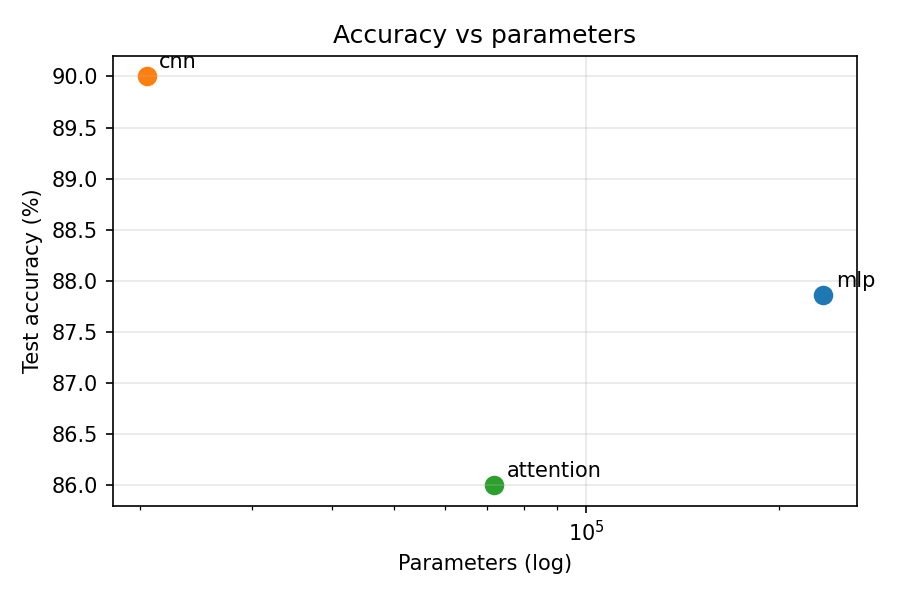
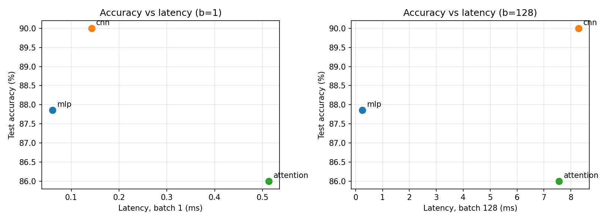

# Lab 3: Architectures and their costs

## 1. Setup

- Dataset: Fashion-MNIST (torchvision), `ToTensor()` + `Normalize((0.2860,), (0.3530,))`
- Split: official 60k train → 55k train / 5k validation (`random_split`, seed 42); official 10k test
- Training: Adam, lr 1e-3, batch 128, 5 epochs, `torch.manual_seed(0)` per model
- Hardware: CPU <model>, `torch.set_num_threads(4)`; Python <version>, PyTorch <version>

Run: `python lab03/cost.py`, `python lab03/train.py`, `python lab03/plot.py`

## 2. Models

| Model     | Architecture                                                                                                           | Params (torchinfo) |
| --------- | ---------------------------------------------------------------------------------------------------------------------- | ------------------ |
| MLP       | Flatten 784 → Linear 256 → ReLU → Linear 128 → ReLU → Linear 10                                                        | 235,146            |
| CNN       | Conv(1→16,3,p1) → ReLU → MaxPool2 → Conv(16→32,3,p1) → ReLU → MaxPool2 → Linear(1568→10)                               | 20,490             |
| Attention | 16 patches of 7×7 → Linear 49→64 → 2× TransformerEncoderLayer (d_model 64, 4 heads, FF 128) → mean pool → Linear 64→10 | 71,818             |

**Parameter target.** None of the architectures, built exactly as specified, falls in the 100k–150k range. The MLP's first layer alone has 200,960 parameters. The CNN's sharing of 3×3 kernels across positions keeps it at 20k. I kept the specified architectures and report the real counts instead of resizing them.

**Deviation.** The attention model has a learnable positional embedding (16 × 64 = 1,024 params). Without it, mean pooling is invariant to patch order and the model cannot use spatial position. Without it the model would have 70,794 params.

## 3. FLOPs: hand-calculated vs measured

Per image, FLOPs = 2 × MACs (Reddi Ch. 4). Bias, ReLU, pooling, softmax and LayerNorm are ignored.

### Hand calculation

| Model     | Layer                  | Formula                   | FLOPs         |
| --------- | ---------------------- | ------------------------- | ------------- |
| MLP       | fc1                    | 2·784·256                 | 401,408       |
|           | fc2                    | 2·256·128                 | 65,536        |
|           | fc3                    | 2·128·10                  | 2,560         |
|           | **total**              |                           | **469,504**   |
| CNN       | conv1                  | 2·3·3·1·16·28·28          | 225,792       |
|           | conv2                  | 2·3·3·16·32·14·14         | 1,806,336     |
|           | fc                     | 2·1568·10                 | 31,360        |
|           | **total**              |                           | **2,063,488** |
| Attention | patch embed            | 2·16·49·64                | 100,352       |
|           | QKV (per layer)        | 2·seq·d·3·d = 2·16·64·192 | 393,216       |
|           | scores QKᵀ (per layer) | 2·seq²·d = 2·16²·64       | 32,768        |
|           | attn·V (per layer)     | 2·seq²·d                  | 32,768        |
|           | out proj (per layer)   | 2·16·64·64                | 131,072       |
|           | FFN (per layer)        | 2·16·64·128·2             | 524,288       |
|           | 2 encoder layers       | 2 × 1,114,112             | 2,228,224     |
|           | head                   | 2·64·10                   | 1,280         |
|           | **total**              |                           | **2,329,856** |

### Comparison

| Model     | Hand      | thop (MACs × 2) | FlopCounterMode |
| --------- | --------- | --------------- | --------------- |
| MLP       | 469,504   | 469,504         | 469,504         |
| CNN       | 2,063,488 | 2,063,488       | 2,063,488       |
| Attention | 2,329,856 | **101,632**     | 2,329,856       |

**Explaining the gap.** For the MLP and CNN, all three methods agree exactly. thop counts MACs without bias and treats ReLU and MaxPool as zero cost, which is the same convention as the hand formula. For attention, thop reports only 101,632 FLOPs, which is exactly patch embed (100,352) + head (1,280). The entire Transformer encoder is missing, because thop counts work only through forward hooks on module types it recognizes:

- The QKV projection is a functional `F.linear` call inside `nn.MultiheadAttention`, so no module hook fires.
- `out_proj` is a `Linear` subclass (`NonDynamicallyQuantizableLinear`) that thop doesn't match.
- The QKᵀ and attention·V matmuls are tensor operations, not modules.
- In eval mode, PyTorch can run each encoder layer as one fused "fast path" kernel, which hides even the FFN `Linear` layers.

`torch.utils.flop_counter.FlopCounterMode` counts at the level of individual operators (mm, addmm, bmm, scaled dot-product attention), so it catches everything and matches the hand calculation. Lesson: hook-based profilers are reliable for simple layer stacks but can badly undercount architectures built from functional ops.

## 4. Inference latency

Protocol: CPU, 4 threads, `model.eval()` + `torch.inference_mode()`, 10 warmup runs, then the median of 100 runs (batch 1) and 20 runs (batch 128), timed with `time.perf_counter`.

| Model     | FLOPs/img | b=1 (ms) | b=128 (ms) | per image at b=128 (ms) | Batching speedup per image |
| --------- | --------- | -------- | ---------- | ----------------------- | -------------------------- |
| MLP       | 0.47 M    | 0.139    | 0.769      | 0.006                   | ~23×                       |
| CNN       | 2.06 M    | 0.471    | 16.143     | 0.126                   | ~3.7×                      |
| Attention | 2.33 M    | 1.061    | 18.901     | 0.148                   | ~7×                        |

## 5. Accuracy

| Model     | Val acc (epoch 5) | Test acc   |
| --------- | ----------------- | ---------- |
| MLP       | 88.22%            | 87.86%     |
| CNN       | 89.60%            | **90.00%** |
| Attention | 86.02%            | 86.00%     |

## 6. Trade-offs

**FLOPs do not predict latency.** The CNN and the attention model have almost the same FLOPs (2.06 M vs 2.33 M), but at batch 1 attention is about 2.3× slower. The MLP has about 4.4× fewer FLOPs than the CNN, yet at batch 128 it is about 21× faster per image. Latency depends on how data moves through memory, not just on arithmetic (§4.7.2–4.7.3).

**MLP: dense, sequential access, broadcast.** Every weight is used exactly once per image. At batch 1, the model reads 0.94 MB of fp32 weights to do 0.47 MFLOPs, an arithmetic intensity of about 0.5 FLOP/byte, which makes it memory-bandwidth-bound. The access is sequential, though, which suits DRAM burst reads and prefetching. Batching broadcasts each weight to 128 inputs and turns the work into one large GEMM. That is why batching gives the MLP its large ~23× per-image speedup and the highest throughput. The cost is parameter count: 235k parameters for the lowest-but-one accuracy, with validation accuracy flat from epoch 2 on. Dense layers have no spatial prior.

**CNN: sliding window, strided access, weight reuse.** Parameter sharing gives the smallest model (20k params, 82 KB, fits in L1/L2 cache) and the highest accuracy. Each 3×3 kernel weight is reused at every output position (784 in conv1, 196 in conv2), giving about 25 FLOPs per byte of weights. The model is close to compute-bound, so batching helps less (~3.7×). Strided window access needs im2col or direct convolution kernels, which are less efficient than one dense GEMM. That is why the CNN has the most FLOPs per image at batch 128. The locality prior (§4.3) fits images well and is what gives it the best accuracy per parameter.

**Attention: dynamic computation, random access, gather.** Attention weights are computed at runtime from the content of each input. Each layer chains many small, dependent ops: QKV projection, per-head reshape, QKᵀ, softmax, attn·V, out projection, LayerNorm, FFN. At this size the cost is dominated by framework dispatch and memory traffic between ops, not by FLOPs, so the attention model has the worst batch-1 latency. The quadratic term is negligible here because seq² = 256 and the scores make up only about 3% of FLOPs, but for long sequences it would dominate both compute and activation memory (Table 4.3: O(B·N²)). Without the convolution's locality prior, the model has to learn spatial structure from data. With 55k images and 5 epochs it reaches only 86%, and its validation accuracy was still rising.

**Conclusion.** On this task, the **CNN is the most cost-effective architecture**. It has the highest accuracy (90.0%) with the smallest memory footprint (20k params, 11.5× fewer than the MLP) because of weight reuse and locality that match the structure of images. The **MLP** is the best choice only when pure throughput matters most: it is the fastest per image at batch 128, at a cost of about 2 percentage points of accuracy and 11× more parameters. The **attention model** is the least cost-effective at this scale: highest latency, middle parameter count, lowest accuracy. Its strength, dynamic all-to-all interactions, matters more for larger data, longer training and longer-range dependencies than for 28×28 images.
