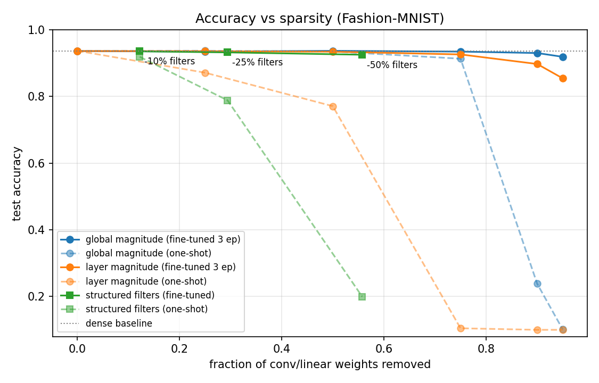
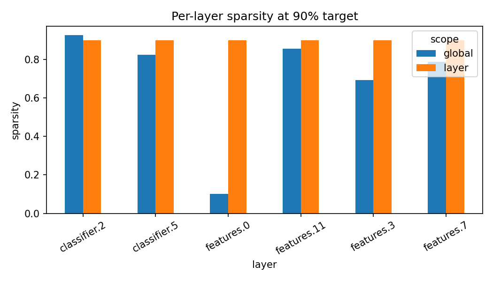
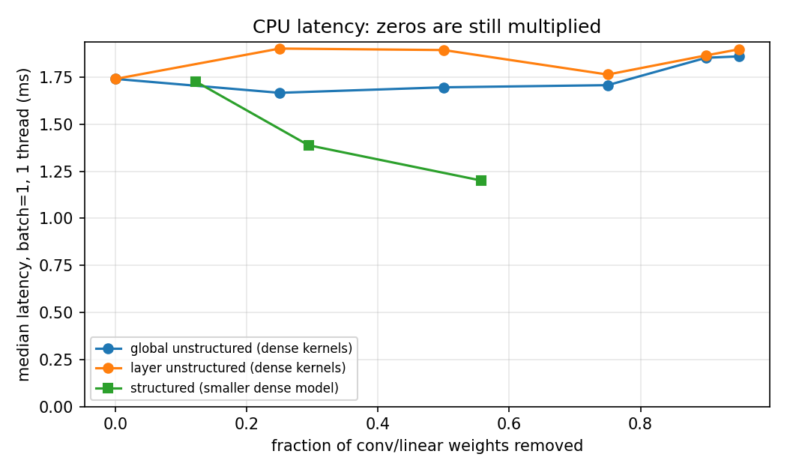
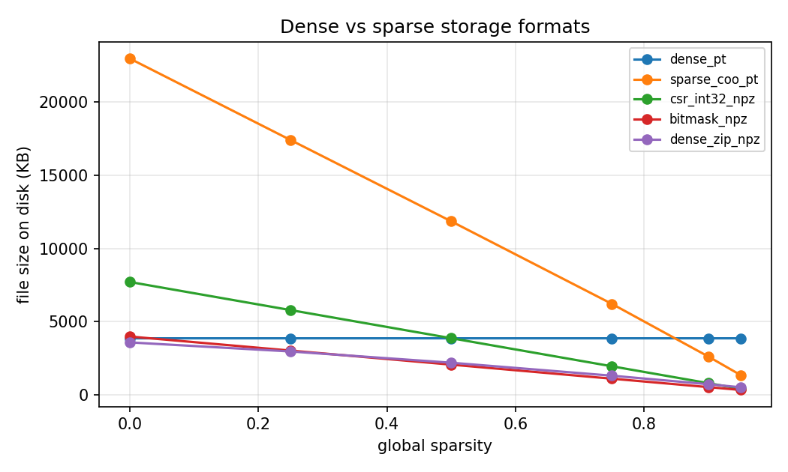
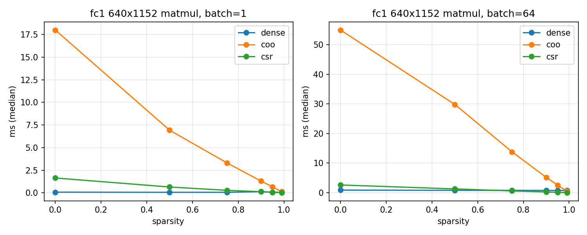
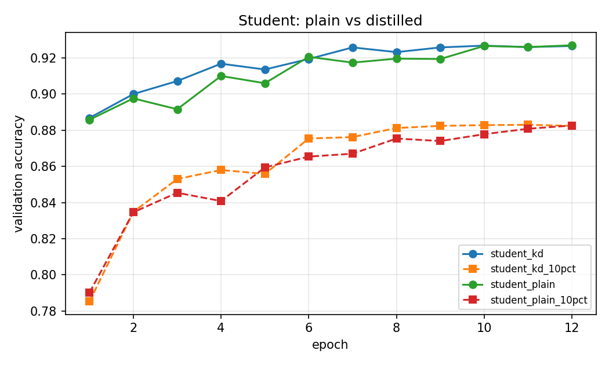

# Lab 7 — Compression: pruning and distillation

Reading: Reddi, Ch. 9 _Efficient AI_ (§9.3 pillars of efficiency, §9.5–9.6 trade-offs),
Ch. 10 §10.3 _Model Optimization Dimensions_, §10.4.1 _Pruning_, §10.4.2 _Knowledge Distillation_.

## How to run

    python lab07/run_lab07.py --quick   # smoke test (10% data, 1 epoch)
    python lab07/run_lab07.py           # full run (CPU, ~1 h; baseline checkpoint is cached)

Outputs: `lab07/results/*.csv`, `lab07/results/summary_by_pillar.md`, `lab07/figures/*.png`.

| Task                                                                        | Where                                                                                                       |
| --------------------------------------------------------------------------- | ----------------------------------------------------------------------------------------------------------- |
| 1. Baseline (985,290 params)                                                | `all_models_profile.csv`, row `baseline`                                                                    |
| 2. Global / layer-wise magnitude pruning, 3-epoch fine-tune with fixed mask | `unstructured_pruning.csv`, `figures/sparsity_curves.png`, `figures/layer_sparsity_90.png`                  |
| 2. Structured pruning (filters by L2 norm, 10/25/50%)                       | `structured_pruning.csv`, same figure                                                                       |
| 3. Latency, dense vs sparse size                                            | `figures/latency_vs_sparsity.png`, `figures/storage_vs_sparsity.png`, `figures/sparse_matmul_benchmark.png` |
| 4. Distillation (student 98,666 params, T=4, α=0.5)                         | `distillation.csv`, `figures/distillation_curves.png`                                                       |
| 5. Pillar table                                                             | `summary_by_pillar.md`                                                                                      |

## Method

- **Data:** Fashion-MNIST, 55k train / 5k validation (split from the train set) / 10k test.
  Normalisation stats are computed on the train split only. Validation is used for monitoring,
  test only for final numbers. Seed 42 everywhere.
- **Baseline:** 4 conv blocks (32-64-128-128, BN, ReLU, max-pool) + FC 1152→640→10. AdamW, lr 1e-3, cosine, 8 epochs.
- **Unstructured pruning:** conv/linear weights are ranked by |w|. _Global_: one threshold for all layers.
  _Layer-wise_: each layer pruned to the same ratio. Mask M is applied (Ŵ = M ⊙ W, Reddi §10.4.1.3), then
  3 epochs fine-tuning at lr 3e-4 with the mask re-applied after every optimizer step.
- **Structured pruning:** in every conv layer the filters with the smallest L2 norm are removed and a
  physically smaller dense network is built (BN, next conv's input channels and FC input columns are sliced too).
- **Distillation:** teacher = baseline. Loss = α·CE(student, y) + (1−α)·T²·KL(p_teacher^T ‖ p_student^T),
  T = 4, α = 0.5. Implemented with `F.kl_div(log_softmax(s/T), log_softmax(t/T), log_target=True)`. This is the
  standard Hinton formulation. The lab sheet writes the KL arguments the other way round, but the direction used
  here (teacher as the target distribution) is the one PyTorch and the original paper use. Plain and distilled
  students share the same initialisation, optimizer, epochs (12) and data. Extra: both students are also trained
  on only 10% of the data (data-efficiency pillar).
- **Latency:** CPU, median of 200 runs after warm-up, batch 1 with 1 thread, batch 64 with all threads.
- **Energy:** an analytical estimate, not a measurement: 4.6 pJ per fp32 MAC + 640 pJ per 32-bit DRAM weight read
  (Horowitz 2014, the source behind Reddi Fig. 10.13). "Dense exec" counts every MAC and weight. "Ideal sparse"
  counts only non-zeros, i.e. what perfect sparse hardware could achieve.

## Results

Full run: CPU (6 threads), seed 42, baseline 8 epochs, fine-tuning 3 epochs, students 12 epochs.
The full table is in `results/summary_by_pillar.md`.

### Summary by efficiency pillar (Reddi Ch. 9)

| Model                        | DATA: samples / supervision    | MODEL: test acc | MODEL: params (non-zero) | MODEL: size on disk | COMPUTE: MMACs dense / non-zero | COMPUTE: latency b=1 / b=64 (ms) | ENERGY: est. µJ dense exec / ideal sparse |
| ---------------------------- | ------------------------------ | --------------- | ------------------------ | ------------------- | ------------------------------- | -------------------------------- | ----------------------------------------- |
| Baseline (teacher)           | 55k / hard                     | **0.9369**      | 985,290 (985,290)        | 3861 KB             | 37.1 / 37.1                     | 1.75 / 27.9                      | 801 / 801                                 |
| Global unstructured 50%      | 55k / hard                     | 0.9369          | 985,290 (493,498)        | 2063 KB (bitmask)   | 37.1 / 23.8                     | 1.90 / 29.5                      | 801 / 426                                 |
| Global unstructured 90%      | 55k / hard                     | 0.9303          | 985,290 (100,065)        | 526 KB (bitmask)    | 37.1 / 8.8                      | 1.81 / 29.2                      | 801 / 105                                 |
| Layer-wise unstructured 90%  | 55k / hard                     | 0.8974          | 985,290 (100,066)        | 526 KB (bitmask)    | 37.1 / 3.7                      | 1.98 / 30.1                      | 801 / 81                                  |
| Global unstructured 95%      | 55k / hard                     | 0.9189          | 985,290 (50,886)         | 334 KB (bitmask)    | 37.1 / 5.4                      | 1.86 / 29.6                      | 801 / 57                                  |
| Structured −10% filters      | 55k / hard                     | 0.9354          | 864,855                  | 3391 KB             | 30.3                            | 1.78 / 27.9                      | 693                                       |
| Structured −25% filters      | 55k / hard                     | 0.9322          | 695,802                  | 2730 KB             | 21.1                            | 1.36 / 20.9                      | 542                                       |
| Structured −50% filters      | 55k / hard                     | 0.9252          | 436,266                  | 1716 KB             | 9.5                             | 1.14 / 11.8                      | 323                                       |
| Student, plain               | 55k / hard                     | 0.9243          | 98,666                   | 394 KB              | 2.0                             | 0.77 / 5.7                       | 72                                        |
| Student, distilled           | 55k / hard + soft (T=4, α=0.5) | **0.9256**      | 98,666                   | 394 KB              | 2.0                             | 0.68 / 4.9                       | 72                                        |
| Student, plain, 10% data     | 5.5k / hard                    | 0.8776          | 98,666                   | 394 KB              | 2.0                             | –                                | 72                                        |
| Student, distilled, 10% data | 5.5k / hard + soft             | 0.8815          | 98,666                   | 394 KB              | 2.0                             | –                                | 72                                        |

### Pruning: accuracy vs sparsity

| Sparsity | Global one-shot | Global fine-tuned | Layer one-shot | Layer fine-tuned |
| -------- | --------------- | ----------------- | -------------- | ---------------- |
| 0%       | 0.9369          | 0.9362            | 0.9369         | 0.9362           |
| 25%      | 0.9371          | 0.9345            | 0.8714         | 0.9359           |
| 50%      | 0.9350          | 0.9369            | 0.7710         | 0.9343           |
| 75%      | 0.9133          | 0.9346            | 0.1047         | 0.9261           |
| 90%      | 0.2382          | 0.9303            | 0.1000         | 0.8974           |
| 95%      | 0.1010          | 0.9189            | 0.1000         | 0.8544           |

| Filters removed | Channels      | Params removed | One-shot | Fine-tuned |
| --------------- | ------------- | -------------- | -------- | ---------- |
| 10%             | 29-58-115-115 | 12.2%          | 0.9189   | 0.9354     |
| 25%             | 24-48-96-96   | 29.4%          | 0.7885   | 0.9322     |
| 50%             | 16-32-64-64   | 55.7%          | 0.1995   | 0.9252     |

The 0%-sparsity row is a control. Three more epochs without pruning give 0.9362 against 0.9369 for the
baseline, so the fine-tuning budget itself does not inflate the pruned results.

### Latency and storage

Micro-benchmark on fc1 (640×1152), median ms, 1 thread:

| Sparsity | b=1 dense | b=1 CSR | b=1 COO | b=64 dense | b=64 CSR | b=64 COO |
| -------- | --------- | ------- | ------- | ---------- | -------- | -------- |
| 0%       | 0.073     | 1.640   | 17.99   | 0.902      | 2.630    | 54.90    |
| 50%      | 0.058     | 0.643   | 6.92    | 0.815      | 1.300    | 29.79    |
| 75%      | 0.060     | 0.279   | 3.32    | 0.807      | 0.619    | 13.81    |
| 90%      | 0.126\*   | 0.125   | 1.30    | 0.785      | 0.261    | 5.18     |
| 95%      | 0.059     | 0.068   | 0.66    | 0.752      | 0.137    | 2.56     |
| 99%      | 0.059     | 0.021   | 0.13    | 0.748      | 0.043    | 0.50     |

\* Outlier (OS noise). At every other sparsity the dense time is ≈0.06 ms, and it does not depend on sparsity.

### Distillation

| Student                | 100% data         | 10% data          |
| ---------------------- | ----------------- | ----------------- |
| Plain (CE only)        | 0.9243            | 0.8776            |
| Distilled (T=4, α=0.5) | 0.9256 (+0.13 pp) | 0.8815 (+0.39 pp) |

## Why unstructured sparsity rarely speeds up dense CPU kernels

1. **The kernel does not know about zeros.** `conv2d`/`linear` call dense GEMM (oneDNN/MKL). A zero weight is
   loaded and multiplied like any other value. Global 90% removes 76% of the useful MACs (37.1 → 8.8 M), but
   latency stays at 1.81 ms against 1.75 ms for the baseline (b=64: 29.2 vs 27.9 ms). The difference is within
   measurement noise. Two students with identical architectures differ by 14% (0.77 vs 0.68 ms), so gaps of
   ~10% mean nothing here.
2. **Sparse formats have overhead.** Every non-zero needs an index, and the input is gathered irregularly, which
   breaks SIMD, cache blocking and prefetching. On fc1 with batch 1, CSR is 22× slower than dense at 0%
   sparsity, still slower at 95%, and wins only at 99% (2.8× faster). COO is slower than dense at batch 1 even at
   99%. With batch 64 the dense GEMM does more work per weight and CSR wins from 75% (and 3× at 90%). The
   break-even point therefore depends on sparsity _and_ batch size. Even so, PyTorch's `conv2d` has no sparse
   path, so the full pruned model gets none of this.
3. **Hardware only exploits regular patterns.** Whole filters/channels (structured), blocks or N:M patterns
   (2:4 on Ampere tensor cores) can be skipped. Removing 50% of filters gives a smaller _dense_ model: 3.9× fewer
   MACs and real speed-ups of 1.54× at b=1 and 2.37× at b=64 (Reddi Table 10.2). The speed-up is below 3.9× at
   b=1 because fixed per-layer overhead dominates such a small input.
4. **Storage is a different story.** Unstructured pruning does shrink the model on disk, given a suitable
   format: a bitmask plus non-zero values takes 526 KB at 90% (7.3× smaller) and 334 KB at 95% (11.6×). The
   in-memory dense tensor is unchanged, though, so RAM, compute and latency stay the same.

## Conclusion

- **Global vs layer-wise.** Global magnitude pruning reaches 90% sparsity at a cost of only 0.66 pp
  (0.9369 → 0.9303). At 95% the cost is 1.8 pp. Layer-wise pruning at the same 90% loses 3.95 pp
  (0.8974), and at 95% it loses 8.3 pp. Layer-wise forces the same ratio on small, sensitive layers (conv1, the
  output FC) and on the compute-heavy convolutions, whereas the global ranking puts most zeros into
  fc1 (738k of 985k parameters). That also explains why layer-wise removes more MACs (37.1 → 3.7 M) but hurts
  accuracy more.
- **Fine-tuning with a fixed mask is essential.** At 90% global sparsity one-shot accuracy collapses to 0.24
  (near chance) and three epochs bring it back to 0.93, a recovery of 69 pp. At 95% it goes from 0.10 to 0.92.
- **Storage ≠ speed.** Unstructured 90–95% pruning cuts on-disk size 7–12×, but CPU latency does not
  change. Only structured pruning gives real speed-ups: −50% filters costs 1.2 pp (0.9252) for 55.7% fewer
  parameters, 3.9× fewer MACs and 1.5–2.4× lower latency.
- **Distillation.** The 98,666-parameter student (10× fewer parameters, 18.6× fewer MACs, 9.8× smaller file,
  2.6×/5.7× faster at b=1/b=64) stays within 1.1 pp of the teacher. Distillation added +0.13 pp with full data
  and +0.39 pp with 10% of the data. The direction matches the theory (soft targets matter more when labels are
  scarce, the data pillar). However, the gain is small and comes from a single seed, so it is not statistically
  established. Several seeds, or a more over-parameterised teacher, would be needed to confirm it. The KD loss also
  converged to the same validation accuracy (0.927) as plain training. On a task this easy, the student's own
  capacity, not the supervision signal, seems to be the limit.
- **Energy.** In the analytical estimate, reading weights from DRAM dominates the baseline cost:
  630 µJ for memory against 171 µJ for MACs (≈79%), which matches Reddi §10.5. Dense execution of an
  unstructured model costs the same 801 µJ. Only sparse-aware hardware could reach the ideal 105 µJ (global 90%).
  Structured pruning (323 µJ) and distillation (72 µJ, 11× less) give savings on ordinary hardware.
- **Recommendation.** For deployment on a commodity CPU, use distillation into a small dense student or
  structured pruning. They improve the model, compute and energy pillars together. Use unstructured pruning
  with a compressed format when the limit is storage or download size, or when the target hardware supports
  sparsity.
